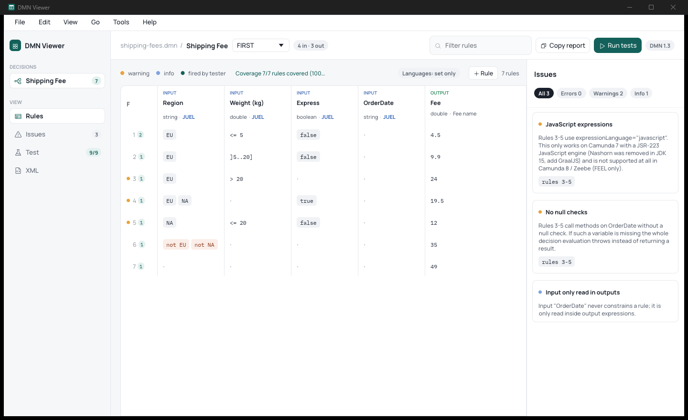
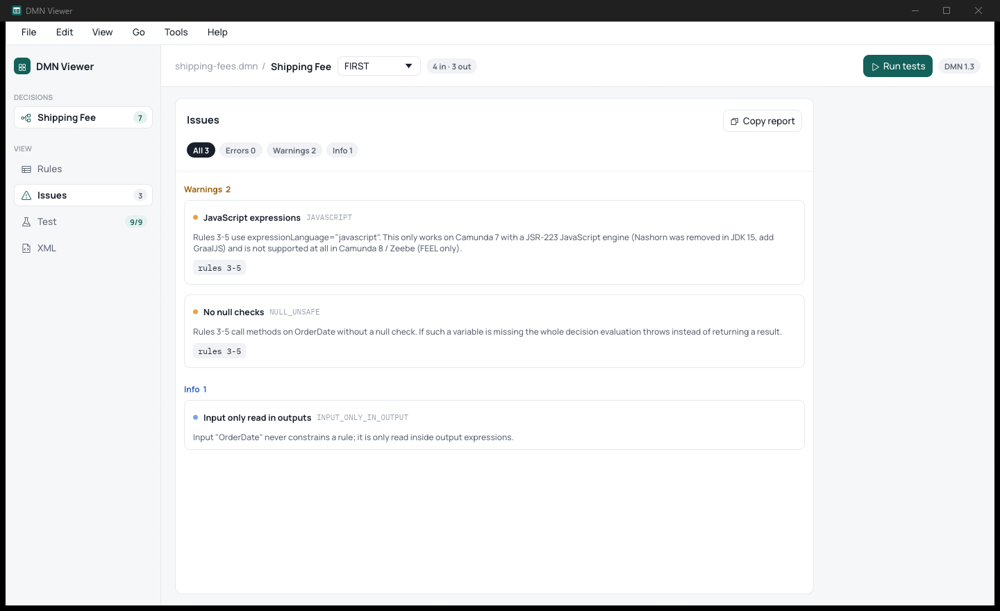
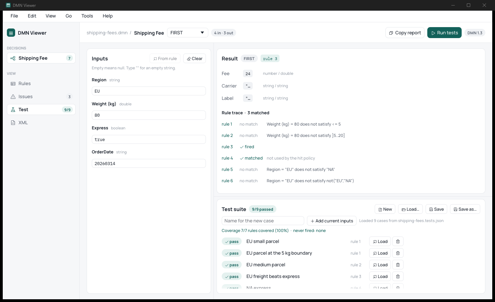

# DMN Viewer

[](https://github.com/th3pajay/dmn-viewer/actions/workflows/ci.yml)
[](https://github.com/th3pajay/dmn-viewer/releases/latest)
[](LICENSE)
[](https://github.com/th3pajay/dmn-viewer/releases/latest)

**Open, check, test and fix DMN decision tables, without installing anything.**
A Windows desktop app for the people who write the rules, and a command-line checker for CI. Each is a single `.exe`.



## What it does

- **Shows the whole table.** Rules, hit policy, types and expression languages at a glance. Reads DMN 1.1 to 1.5 and shows the file's version.
- **Edits in place.** Change cells, headers, hit policy, rules and columns. Saving rewrites only what you changed, so the diagram, namespaces, comments and formatting stay exactly as they were.
- **Finds problems.** Invalid FEEL, unreachable and overlapping rules, input combinations no rule covers, values outside the allowed list, placeholders, unused inputs, JavaScript that won't run on Camunda 8, and more.
- **Fixes them with you.** Each fix shows the change and its effect on your tests before you confirm it, and every fix can be undone.
- **Tests the logic.** Try any inputs and see which rule fires and why. Right-click a rule to fill in inputs that make it fire. Keep test suites next to your DMN files and see which rules they never reach.
- **Stays fast.** A 5,000-rule table opens and is fully checked in about 50 ms.

<table>
  <tr>
    <td width="50%"></td>
    <td width="50%"></td>
  </tr>
  <tr>
    <td align="center"><sub>Issues, with automatic fixes where possible</sub></td>
    <td align="center"><sub>The tester: inputs, result, rule trace and test suite</sub></td>
  </tr>
</table>

## Download

1. Get the zip from the [latest release](https://github.com/th3pajay/dmn-viewer/releases/latest).
2. Unzip it anywhere and run `dmn-viewer.exe`. Nothing is installed, and nothing else is needed.

Neither program sends anything over the network.

Every release is built by GitHub Actions from the tagged source and scanned on VirusTotal; the release notes list the checksums and scan results. To check that a download is that build and unchanged:

    gh attestation verify dmn-viewer-<version>-windows-x64.zip --repo th3pajay/dmn-viewer

The executables are not code-signed yet, so on first start Windows SmartScreen may say "Windows protected your PC". Choose **More info**, then **Run anyway**.

## Quick start

Open the bundled example to look around:

    dmn-viewer.exe examples\shipping-fees.dmn

- Double-click a cell or header to edit it; right-click a rule for more options, including **Test this rule**.
- **Fix issues** walks through every issue that has an automatic fix: Enter applies, S skips, Esc stops.
- Ctrl+S saves, Ctrl+Z / Ctrl+Y undo and redo, Ctrl+D reviews unsaved changes, Ctrl+W closes the file, Ctrl+K opens the command palette.

To check files in CI:

    dmn-check.exe "rules/**/*.dmn" --sarif --fail-on warn

---

<details>
<summary><b>Desktop app options</b></summary>

    dmn-viewer.exe [file.dmn] [--tab rules|issues|test|xml] [--case N] [--rule N] [--dark]

Press F1 in the app for every keyboard shortcut.

</details>

<details>
<summary><b>Command-line checker</b></summary>

    dmn-check.exe <file.dmn | dir | glob> [...] [--test suite.json] [--coverage]
                  [--json | --junit | --sarif] [--fail-on error|warn|never]

- Exit code 1 when an error is found or a test fails, 2 for a usage error.
- `--fail-on warn` also fails on warnings.
- Quote globs such as `"rules/**/*.dmn"`.
- SARIF works with GitHub code scanning.

</details>

<details>
<summary><b>Test suites</b></summary>

A `<name>.tests.json` next to `<name>.dmn` is loaded automatically:

```json
{
  "decision": "ShippingFee",
  "cases": [
    { "name": "EU small parcel", "inputs": { "Region": "EU", "Weight": 2.5 }, "expected": { "Fee": 4.5 }, "expectRules": [1] },
    { "name": "Missing date", "inputs": { "Region": "EU", "Weight": 30 }, "expectError": true }
  ]
}
```

Only the outputs a case lists are checked. For COLLECT (with no aggregation), RULE ORDER and OUTPUT ORDER tables, give one value per result row: `"expected": { "Fee": [4.5, 2] }`. A single value means exactly one row.

</details>

<details>
<summary><b>Build from source</b></summary>

    cargo build --release
    target\release\dmn-viewer.exe examples\shipping-fees.dmn
    target\release\dmn-check.exe examples\shipping-fees.dmn

Requires Windows with the MSVC toolchain and Rust 1.92 or newer. The C runtime is linked statically, so the executables run on a clean machine.

</details>

<details>
<summary><b>Development</b></summary>

    cargo test
    cargo fmt --check
    cargo clippy --all-targets

| Path | Contents |
|---|---|
| `src/model.rs`, `src/parse.rs` | DMN model and XML parsing |
| `src/edit.rs`, `src/diff.rs` | Byte-preserving edits; unsaved changes as line hunks |
| `src/lint.rs`, `src/gaps.rs`, `src/fix.rs` | The checks, missing-combination search, and automatic fixes |
| `src/unary.rs`, `src/eval.rs` | Unary tests; the FEEL, JavaScript and JUEL evaluator |
| `src/suite.rs`, `src/session.rs` | Test suites, rule coverage, and the tester's state |
| `src/report.rs`, `src/targets.rs`, `src/export.rs` | `dmn-check` output formats; directory and glob expansion; table export |
| `src/workspace/` | The open file, rule operations and the fix session |
| `src/main.rs`, `src/menu.rs` | Desktop app and its menus, shortcuts and settings |
| `src/bin/dmn-check.rs` | Command-line checker |
| `examples/`, `tests/`, `assets/`, `docs/` | Example table and suite, integration tests, embedded fonts and icons, screenshots |

Real decision tables stay out of the repository: `.gitignore` excludes every `*.dmn` and `*.tests.json` outside `examples/`. [GLOSSARY.md](GLOSSARY.md) defines the domain terms used in the code.

</details>

## License

MIT, see [LICENSE](LICENSE). The bundled fonts and icons have their own licenses, listed in [assets/LICENSES.txt](assets/LICENSES.txt).
